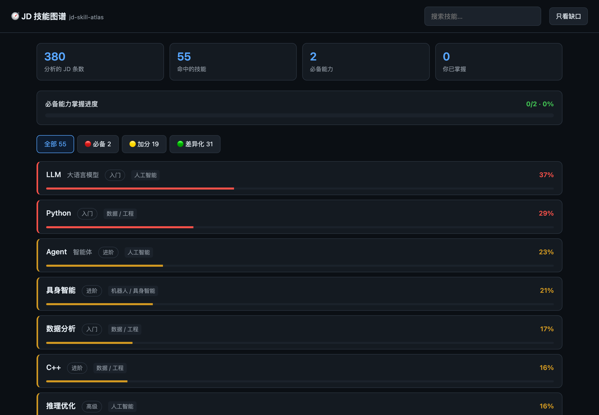

<div align="center">

# 🧭 jd-skill-atlas · JD 技能图谱

**把一堆岗位 JD 变成一张排序好的能力地图 —— 并且把每个术语讲清楚。**
扫描你所有的目标岗位，提炼出这个行业真正要求什么，分成必备 / 加分 / 差异化，
再生成一套带学习路径的离线学习平台。

[](https://www.python.org/)
[](LICENSE)
[]()

[English](README.md) · [简体中文](README.zh-CN.md)

</div>

---

## 要解决的问题

你扫了 300 个岗位，拿到一张列表。然后呢？

这些 JD 里全是似懂非懂的词 —— *VLA*、*Sim2Real*、*KV Cache*、*DPI*、*返投*。
你分不清哪些是**入场券**（人人都要），哪些是**差异化的加分项**（少见，但一旦有就决定性）。
就算认识这个词，你也不知道**先学哪个**。

关键词提取器解决不了这个问题 —— 它只会给你一团词云。

**jd-skill-atlas 给你的是课程表。**

---

## 它做什么

```
   380 条 JD  ──▶  抽取  ──▶  按覆盖率分级  ──▶  逐条解释  ──▶  学习平台
                    │                              │
              对照一份人工整理的              每个术语都有：
              技能词典（58 个 / 5 大领域）     是什么 / 为什么要 / 怎么落地
                                               + 前置技能
                                               + 学习步骤
                                               + JD 原文证据
```

| 输出 | 含义 |
|---|---|
| 🔴 **必备** | ≥25% 的岗位要求。这是入场券 —— 没有就被筛掉。 |
| 🟡 **加分** | 8–25%。能让你在候选池里更靠前。 |
| 🟢 **差异化** | <8%，但少见，一旦有就是优势。 |
| 📖 **术语词典** | 每个词分三层讲：是什么 → 为什么这个岗位要 → 具体怎么落地（含常见坑）。 |
| 🗺 **学习路径** | 按前置依赖拓扑排序。是 Python → LLM → Agent，而不是按字母排。 |
| ❓ **词典缺口** | 高频出现但词典还没收录的词 —— 一份「怎么让下次更准」的待办清单。 |

---

## 快速开始

```bash
pip install jd-skill-atlas      # 或 pip install -e .

# 指向你的 JD 集合（直接兼容 cn-job-radar 的输出）
atlas analyze ~/.cn-job-radar/data/scored

atlas ui                        # 打开学习平台 127.0.0.1:8899
```



<sub>按分级着色。点开任何一项看完整解释；学完打勾，进度条会追踪你对「必备能力」的覆盖度。</sub>

**查一个术语：**

```bash
$ atlas explain VLA

  VLA（视觉-语言-动作模型）
  ══════════════════════════════════════════════════
  领域：机器人 / 具身智能   熟练度：进阶

  【一句话】
  把「看到的画面 + 听到的指令」直接映射成「机器人该做的动作」的端到端模型。

  【为什么这个岗位要它】
  这是当前具身智能最核心的技术路线。过去机器人靠人工写规则（看到红色就抓），
  现在靠一个大模型直接从视觉和语言生成动作……

  【怎么学】
   1. 先搞懂 Transformer 和注意力机制 —— VLA 的骨架就是它
   2. 读 RT-1 / RT-2 / OpenVLA 三篇论文，重点理解「动作离散化」
   …
```

---

## 为什么不用 LLM

同类工具几乎都是「每份 JD 调一次大模型」。代价是：要 API key、按次花钱、
输出不确定所以没法 diff、而且你的求职记录得离开本机。

jd-skill-atlas 的抽取用的是**人工整理的词典 + 规则**：

- **零成本、零 key** —— 断网也能跑
- **结果确定** —— 同样输入永远同样输出，两次运行可以 diff
- **纯本地** —— 求职过程不出这台机器
- **快** —— 380 条 JD 不到一秒

代价是对覆盖率要诚实：词典认识 58 个技能，不是全部。
**「词典缺口」列表就是为此存在的** —— 它明确告诉你哪些高频词还没被收录，
于是你去补词典，而不是瞎猜。LLM 可以用来填这些缺口，但它永远不在主链路上。

---

## 技能词典

58 个技能，覆盖 5 大领域。**这是最值得贡献的部分。**

| 文件 | 领域 | 例子 |
|---|---|---|
| `robotics.yaml` | 机器人 · 具身智能 | VLA、SLAM、运控、灵巧手、Sim2Real、力控、世界模型 |
| `ai.yaml` | 人工智能 | Transformer、MoE、KV Cache、RLHF、RAG、Agent、推理优化 |
| `investment.yaml` | 投资 · 金融 | IRR、DPI/TVPI、尽调、Term Sheet、募投管退、引导基金 |
| `tools.yaml` | 工具 · 工程 | Python、PyTorch、CUDA、ROS、Docker、Git、SQL |
| `common.yaml` | 通用能力 | 项目管理、需求分析、商业分析、行业研究 |

每个词条**必须三层齐全** —— 只写一个定义是不合格的：

```yaml
- id: vla
  name: VLA
  zh: 视觉-语言-动作模型
  what: 把「看到的画面 + 听到的指令」直接映射成「机器人该做的动作」的端到端模型。
  why:  |
    这是当前具身智能最核心的技术路线…… JD 里出现 VLA，
    基本意味着这家公司在做通用机器人的「大脑」，而不是专用设备。
  how:  |
    典型 VLA 把三块拼起来：视觉编码器、语言模型、动作头。
    三个常见坑：动作空间不统一、真机数据太少、推理延迟跟不上控制频率。
  prerequisite: [transformer, imitation-learning]
  learn_path:
    - 先搞懂 Transformer 和注意力机制
    - 读 RT-1 / RT-2 / OpenVLA，重点理解「动作离散化」
    - 跑通一个开源 VLA
```

想覆盖或扩充任何一条？把同名 YAML 放到 `~/.jd-skill-atlas/skills/` 即可。

---

## 命令

```bash
atlas analyze <文件或目录> [--title T] [--have "Python,SQL"]
atlas ui [--port 8899]          # 学习平台
atlas explain <技能>            # 查一个术语（中英名均可，支持模糊匹配）
atlas skills [--domain ai]      # 列出词典
atlas path --jd <目录>          # 按前置依赖排序的学习路径
```

### 输入格式

任何「像岗位」的结构都行。[`cn-job-radar`](https://github.com/WEIWEI0614/cn-job-radar)
的输出开箱即用：

```json
[{"title": "具身智能产品经理", "company": "某公司",
  "location": "北京", "url": "https://…",
  "jd": "岗位职责…任职要求…"}]
```

单个文件、一个目录、或者裸数组，都能吃。

---

## 分级阈值是怎么定的

覆盖率 =（提到该技能的 JD 数）/（分析的 JD 总数）。

阈值是按**混合岗位池**标定的。如果你把「机器人算法岗」和「投资岗」放在一起扫，
不会有任何技能覆盖到 80% —— 岗位差异太大了。
实测下来 25% 才是真正区分「入场券」和「其他」的分水岭。
如果你的池子是同质的（比如只看算法岗），可以改 `core.py` 里的 `Atlas.MUST`。

---

## 参与贡献

**价值最高的贡献是一条词典词条。** AI 和机器人领域的术语变化很快，
词典才是让这个工具有用的东西 —— 否则它就只是词云。

也欢迎：新的领域词典、覆盖率的改进、以及真实求职过程中发现的 bug。

---

## 隐私

全部本地运行。你的 JD、技能清单、学习进度都不会离开这台机器。
无账号、无埋点、无上传通路。

详见 [SECURITY.md](SECURITY.md)。

## 许可

MIT — 见 [LICENSE](LICENSE)。
